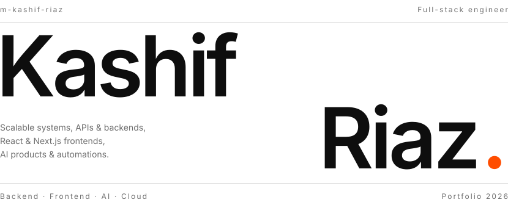
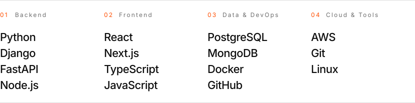

<picture>
  <source media="(prefers-color-scheme: dark)" srcset="assets/hero-dark.svg">
  
</picture>

<h6>01 / ABOUT</h6>

Full-stack software engineer who designs and builds scalable, production-grade applications across system architecture, APIs and backend services, databases, cloud infrastructure and clean, fast frontends.

I also build AI-powered products and large AI features, from end-to-end AI automations to LLM-driven workflows using ChatGPT and Claude, engineered with the same focus on reliability, performance and scale.

Day to day: Python, Django, FastAPI and Node.js on the backend; React, Next.js, TypeScript and JavaScript on the frontend; PostgreSQL and MongoDB for data; Docker, GitHub and AWS to ship it.

<h6>02 / STACK</h6>

<picture>
  <source media="(prefers-color-scheme: dark)" srcset="assets/stack-dark.svg">
  
</picture>

<h6>03 / CONTACT</h6>

<picture>
  <source media="(prefers-color-scheme: dark)" srcset="assets/contact-dark.svg">
  
</picture>

<a href="https://github.com/m-kashif-riaz">GitHub ↗</a> &nbsp;&nbsp;·&nbsp;&nbsp; <a href="https://www.linkedin.com/in/kashif-riaz-se/">LinkedIn ↗</a> &nbsp;&nbsp;·&nbsp;&nbsp; <a href="mailto:riazkashif1204@gmail.com">Email ↗</a>

